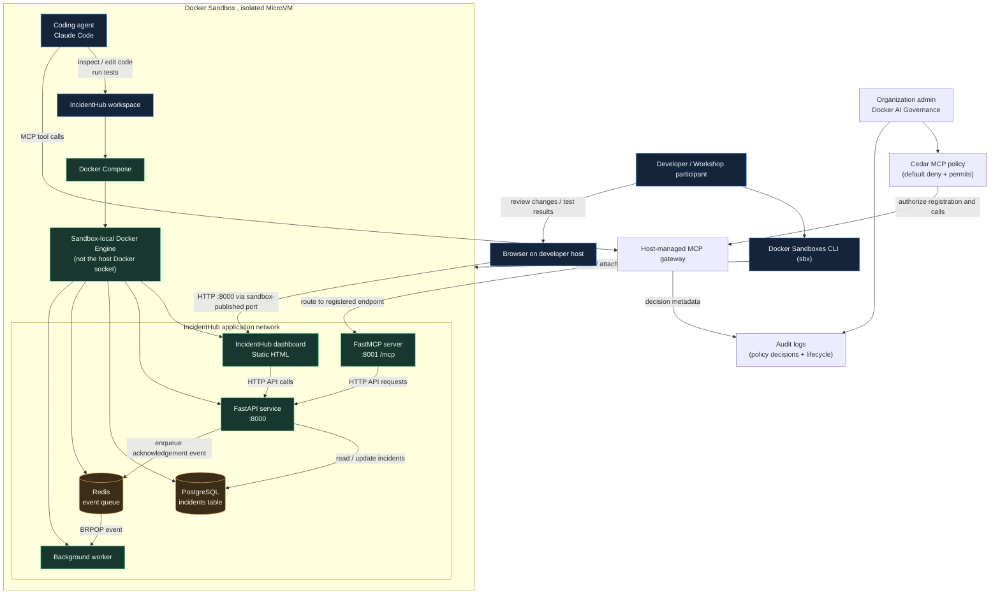

# IncidentHub architecture

This diagram shows the complete workshop topology, including the Docker Sandbox boundary and the application services running inside it.

## Runtime architecture

## Request and event flows

1. The participant starts a local sandbox with `sbx run claude .` or provisions a Cloud Sandbox with the supported `sbx --cloud` workflow.
2. The coding agent works on the checked-out IncidentHub workspace from inside the MicroVM. The sandbox has its own Docker Engine; it does not need access to the host Docker socket.
3. Docker Compose starts the API, PostgreSQL, Redis and worker services on the application network.
4. The participant opens the dashboard through the sandbox's published application port. The dashboard calls the FastAPI endpoints.
5. The API reads incident records from PostgreSQL. Acknowledging an incident writes its status to PostgreSQL and pushes an event to Redis; the worker consumes that event.
6. The agent investigates the intentionally slow checkout-summary endpoint, adds a regression test and removes the deliberate blocking delay.

## Security boundaries

- **Contain:** the coding agent and its commands execute inside the MicroVM boundary. The sandbox uses its own Docker Engine rather than mounting the host Docker socket.
- **Control:** outbound agent traffic is governed by the sandbox network policy/proxy. The Compose application network is separate from the agent's outbound network path.
- **Choice:** the FastMCP service exposes three read-only incident lookup tools and one write tool. The Docker Sandboxes MCP gateway registers and loads the remote endpoint for the sandbox.
- **MCP governance:** organization Cedar policy controls registration and gateway-mediated calls. The write tool is marked non-read-only and destructive, so a policy can require in-session confirmation or forbid it. Direct MCP connections bypass gateway Cedar policy and must be controlled by network policy.
- **Audit:** audit logs record policy decisions and sandbox lifecycle metadata for governed local sandboxes. They do not capture prompts, agent output or tool argument values. Cloud sandboxes use separate cloud policy logs.
- **Capacity:** local and cloud sandboxes are separate environments. A cloud sandbox does not automatically inherit the local workspace, credentials or policy; clone the repository and configure required resources there.

## Components

| Component | Responsibility |
|---|---|
| `sbx` CLI | Creates, attaches to and manages local or cloud sandboxes |
| Coding agent | Reads the project, diagnoses the incident, edits code and runs tests |
| Docker Engine + Compose | Runs the application stack inside the sandbox |
| Dashboard | Browser UI served by the API container |
| FastAPI | Health, incident listing, acknowledgement and checkout summary endpoints |
| PostgreSQL | Stores the seeded synthetic incident records |
| Redis | Buffers acknowledgement events |
| Worker | Consumes events from Redis |
| FastMCP server | Exposes incident lookup and acknowledgement tools over Streamable HTTP |
| Docker Sandboxes MCP gateway | Routes registered MCP tools to the sandboxed agent |
| Cedar policy and audit | Governs MCP registration/tool use and records policy decisions where AI Governance is enabled |
| Regression test | Checks that checkout summary responds in under 350ms |

> **Prerequisites:** Docker Sandboxes CLI (`sbx`) and a supported agent. Docker Desktop is not required to run `sbx`. The application stack uses Docker Engine and Docker Compose inside the sandbox.
